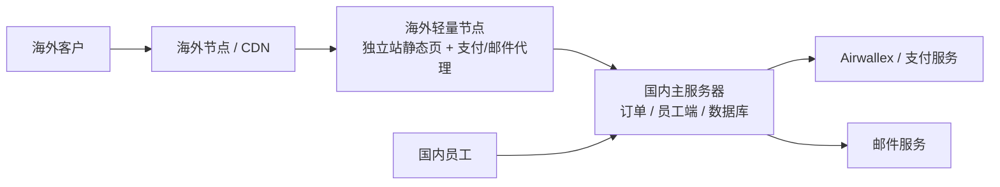

# 海外独立站架构方案

## 1. 结论

**采用「国内主服务器 + 海外轻量节点」的混合架构。**

- 国内保留核心业务：订单、数据库、员工端、建模/生产/跟单。
- 海外轻量节点只做入口和海外 API 接入：独立站静态页、支付、邮件、Webhooks。
- 不建议只靠国内裸机直连 Airwallex 等海外支付服务。

## 2. 为什么不只放国内

- 海外客户访问国内服务器延迟高、丢包多，图片和聊天体验差。
- 国内直连 Airwallex / PayPal 等海外 API 和 Webhook，TLS 握手更不稳，国内 IP 信誉也更容易被风控标记。
- 阿里沟通中实测国内到海外支付 API 延迟可到 500ms 以上。

## 3. 推荐拓扑

- 海外客户访问海外节点，加载快。
- 支付、邮件、Webhook 走海外节点，再由海外节点安全转给国内主服务。
- 国内员工直接访问国内 API/员工端，不受海外线路影响。

## 4. 各模块放哪里

| 模块 | 放国内 | 放海外 |
| --- | --- | --- |
| 订单、数据库、业务主流程 | 是 | 否 |
| 员工端 `frontend` / 8854 | 是 | 否 |
| B2C 独立站 `b2c-web` / 8853 | 可保留源站 | 主要入口 |
| B2B 8852 | 是 | 否 |
| API 8851 | 是 | 可经海外节点转发 |
| 支付、邮件、Webhook | 只做业务处理 | 接入与转发 |
| 图片、JS、CSS、视频 | 可缓存到 CDN | 可缓存到 CDN |

## 5. 与阿里云沟通后的落地方式

1. **国内主服务器**：继续部署现有系统（API 8851、B2B 8852、B2C 8853、员工端 8854、MySQL）。
2. **海外轻量节点**：
   - 放 `b2c-web` 静态站
   - 放一个很小的支付/邮件代理服务
   - 负责接 Airwallex、邮件服务商、支付 Webhook
3. **网络打通**：
   - 国内和海外节点用阿里云云企业网或专线/内网互联打通
   - 海外节点再回传国内 API
4. **加速**：
   - 如果仍保留国内源站，可叠加阿里云 G1 或 CDN
   - 如果海外节点已部署独立站，CDN 可只服务静态资源

## 6. 支付怎么接

- 前端只发起「创建支付」请求。
- 海外节点调用 Airwallex 创建支付意图、跳转收银台。
- Webhook 先打到海外节点，再由海外节点安全转发给国内 API。
- 密钥只放在海外节点和服务器环境变量里，不进前端。

## 7. 邮件和二维码

- 登录验证码、订单通知、二维码名片都从后端或任务队列发送。
- 邮件建议走专业邮件服务，避免国内 SMTP 直发谷歌等邮箱被拉黑。

## 8. 当前系统对应的端口

- API：8851
- B2B：8852
- B2C：8853
- 员工端：8854

建议以后统一走域名和 HTTPS，把 8851–8854 的反代挂在同一域名或子域名下，减少海外网络对非标端口的限制。

## 9. 采购建议（按阿里沟通记录）

- 国内主服务器：4 核 16G，500G 磁盘，100M 按量带宽（按业务增长再调）
- 海外轻量节点：2 核 4G 或 4 核 8G，200M 带宽即可
- 双十一期间可按活动价采购实例
- 海外节点先选北美，后续再扩欧洲、澳洲

## 10. 一句话总结

**国内保留业务核心，海外只做客户入口和海外服务接入。** 这套架构最适合后面接 Airwallex、邮件、二维码和海外独立站。